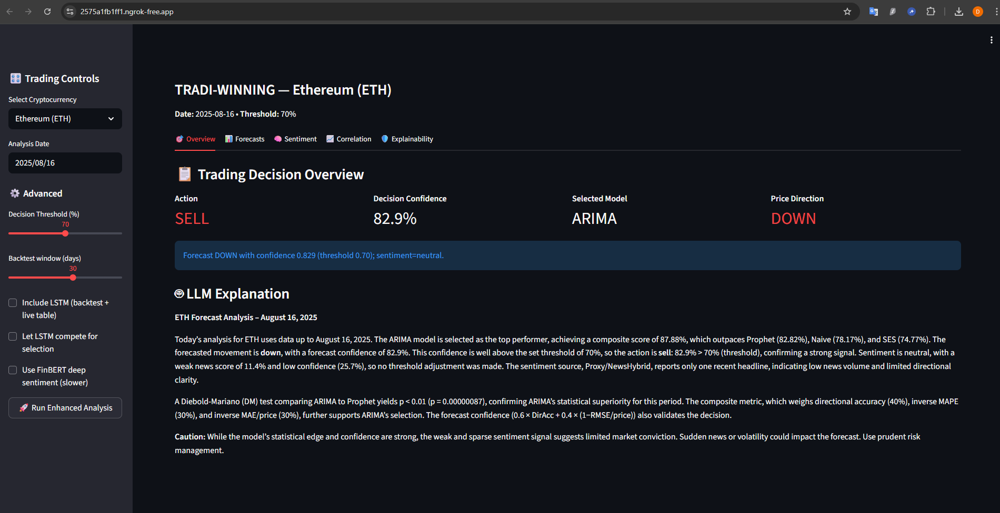
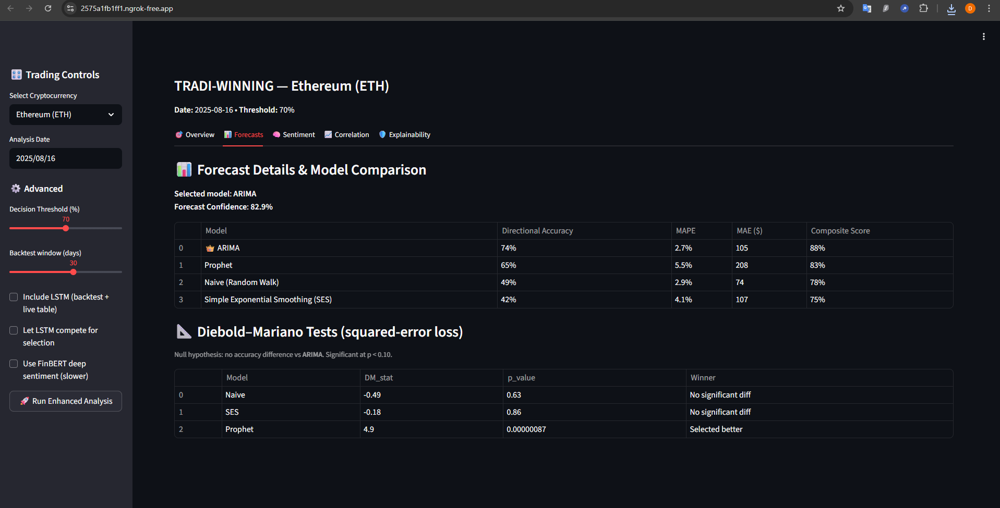
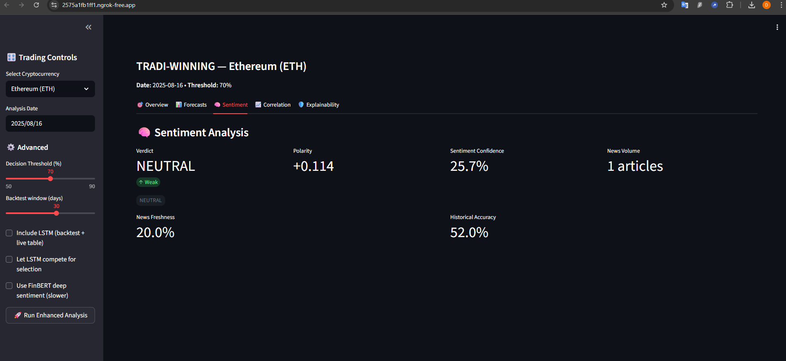
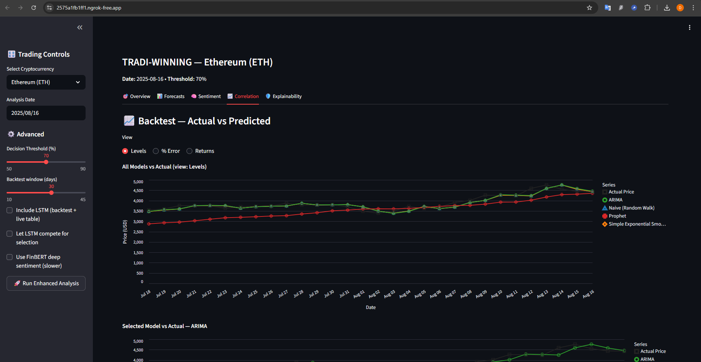

# 📈 MCP-TRADI-WIN  
## A Trustworthy Multi-Agent System for Explainable Crypto Trading

🎓 **Master’s Thesis Project**

This repository presents **MCP-TRADI-WIN**, a **transparent and auditable multi-agent cryptocurrency forecasting and trading framework**.  
The system integrates **time-series forecasting**, **sentiment analysis**, and **LLM-based explanation** under a **Model Context Protocol (MCP)** to generate **metric-driven, explainable trading decisions**.

> ⚠️ **Large Language Models (LLMs) are used strictly for explanation, not for prediction or decision-making.**

📄 **Full thesis manuscript:** [`Thesis.pdf`](./Thesis.pdf)

---

## 🔍 Project Motivation

Cryptocurrency markets are highly volatile, while many AI-driven trading systems rely on opaque models with limited interpretability.  
This work addresses these issues by proposing a system that emphasizes:

- Explicit **multi-agent responsibilities**
- **Metric-driven model selection**
- **Sentiment-adjusted decision thresholds**
- Full **traceability and auditability**

The objective is not short-term profit maximization, but the design of a **trustworthy AI decision-support system for financial forecasting**.

---

## 🧠 System Overview

The framework is coordinated through a **Model Context Protocol (MCP)**, which enables:

- Unified context sharing across agents  
- Standardized inter-agent communication  
- Traceable intermediate states and decisions  

### 🤖 Agent Roles

- **Data Collection Agent**  
  Retrieves cryptocurrency price data and relevant news headlines from open APIs.

- **Forecasting Agent**  
  Compares multiple predictors:
  - ARIMA  
  - Prophet  
  - LSTM (optional)  
  - Naive Random Walk (RW)  
  - Simple Exponential Smoothing (SES)

- **Sentiment Agent**  
  Computes market sentiment using:
  - TextBlob (primary)
  - Optional FinBERT validation  
  Sentiment strength, freshness, and news volume are explicitly modeled.

- **Decision Agent**  
  Produces trading actions using confidence thresholds dynamically adjusted by sentiment alignment.

- **Explanation Agent (LLM-based)**  
  Generates **human-readable explanations** using only the system’s computed outputs.

---

## 📐 Model Selection & Decision Logic

### 🏆 Composite Model Selection Metric

The best forecasting model is selected using a weighted score:

- **40%** Directional Accuracy  
- **30%** (1 − Mean Absolute Percentage Error)  
- **30%** (1 − MAE / Price)

This balances directional correctness with scale-normalized error control.

---

### 🎯 Trade Signal Confidence

Final decision confidence is computed as:

- **60%** Directional Accuracy  
- **40%** (1 − RMSE / Price)

A trade is executed only when this confidence exceeds the **sentiment-adjusted threshold**.

---

### 🧠 Sentiment-Adjusted Thresholds

- Sentiment supports forecast → threshold reduced by 10%  
- Sentiment contradicts forecast → threshold increased by 10%  
- Weak or neutral sentiment → no adjustment  

This ensures sentiment informs, but does not dominate, quantitative evidence.

---

## 🖥️ Interactive Dashboard (Research Demonstration)

An interactive **Streamlit dashboard** was developed to visualize, inspect, and stress-test the system’s behavior.

### Key Views
- Trading decision overview and confidence  
- Model comparison and backtests  
- Sentiment diagnostics  
- Explainability trace and what-if analysis  

> 🧪 The dashboard is intended as a **research and inspection tool**, not a production trading platform.

---

## 🖼️ Screenshots

### 🎯 Trading Decision Overview


### 📊 Forecast Comparison


### 🧠 Sentiment Analysis


### 📈 Backtest Correlation


### 🛡️ Explainability & What-If Analysis


---

## 📂 Repository Structure

```
Tradi-Win-Explainable-Trading-Agents/
├── notebook/
│   └── TRADI_WIN_MCP_MultiAgent_Thesis.ipynb   # Full research implementation
├── screenshots/                               # Dashboard screenshots
├── Thesis.pdf                                 # Master’s thesis manuscript
└── README.md                                  # Project documentation
```

The Jupyter notebook contains the **complete implementation**, including:
- MCP orchestration  
- Agent logic  
- Experiments and evaluation  
- Explainability traces  

The notebook-first structure is intentional and prioritizes **research transparency and reproducibility**.

---

## 📊 Experimental Results (Summary)

Using **Ethereum (ETH)** daily data  
📅 *August 17, 2024 – August 16, 2025 (365 days)*

- Selected model: **ARIMA**
- Composite performance score: **87%**
- Final decision confidence: **81.1%**
- Sentiment-adjusted threshold: **70%**
- Result: **Definitive trading recommendation**

Statistical validation includes **Diebold–Mariano tests** confirming model superiority.

---

## 🔐 Trustworthy AI Principles

✔ Metric-driven decisions  
✔ Explicit thresholds  
✔ Bounded sentiment influence  
✔ Explanation-only LLM usage  
✔ Full audit trail  

The system is designed to support **review, compliance, and governance**.

---

## 🚀 Future Extensions

- Modular Python core package  
- Full Streamlit deployment  
- Multi-asset portfolio extension  
- Live data pipelines  

---

## 📌 Disclaimer

This project is **academic research** and **not financial advice**.  
All outputs are for demonstration and evaluation purposes only.

---

## 👤 Author

**Daniel Ojeda**  
Master’s in Artificial Intelligence  

---

## 🏷️ Keywords

Multi-Agent Systems · Model Context Protocol · Explainable AI · Cryptocurrency Trading · Large Language Models · Trustworthy AI
